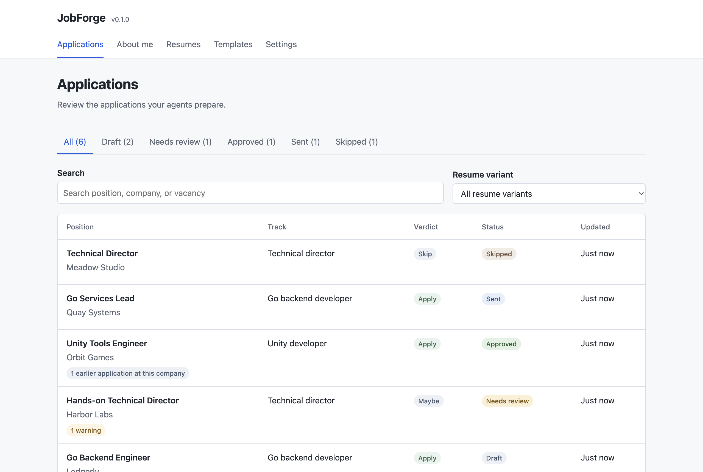
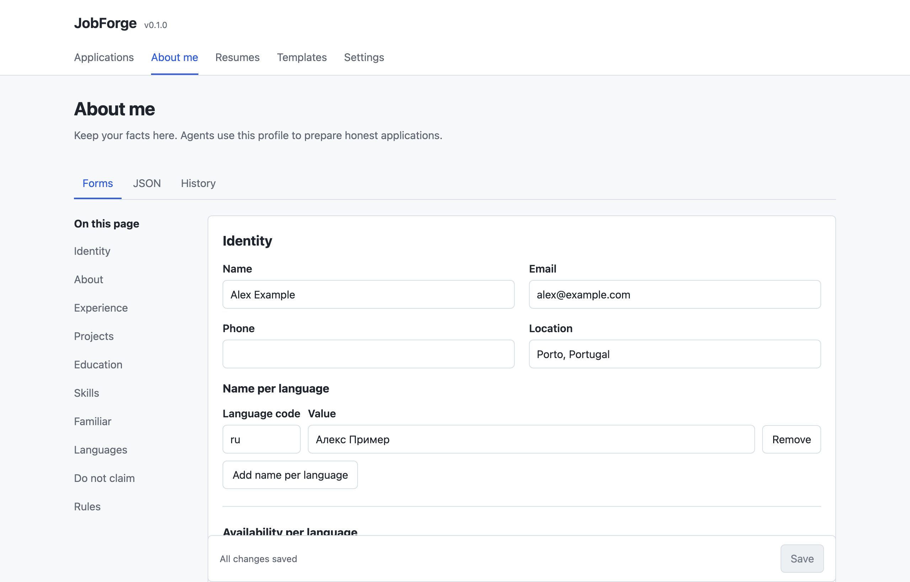
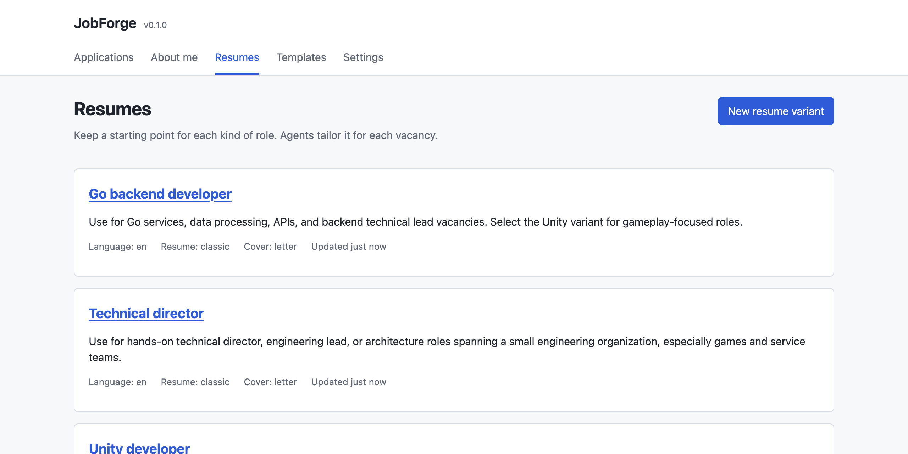
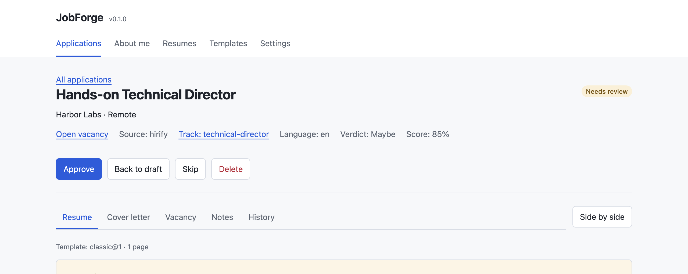
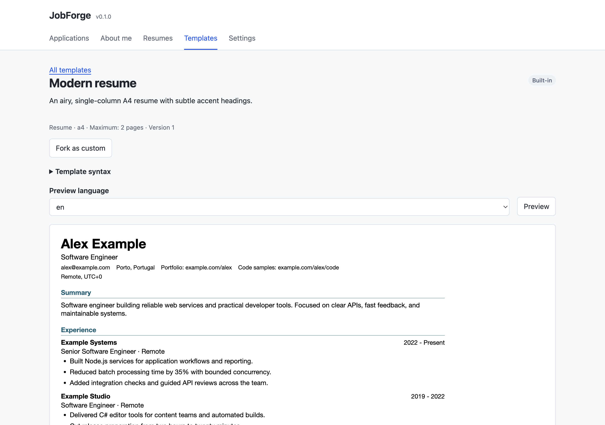
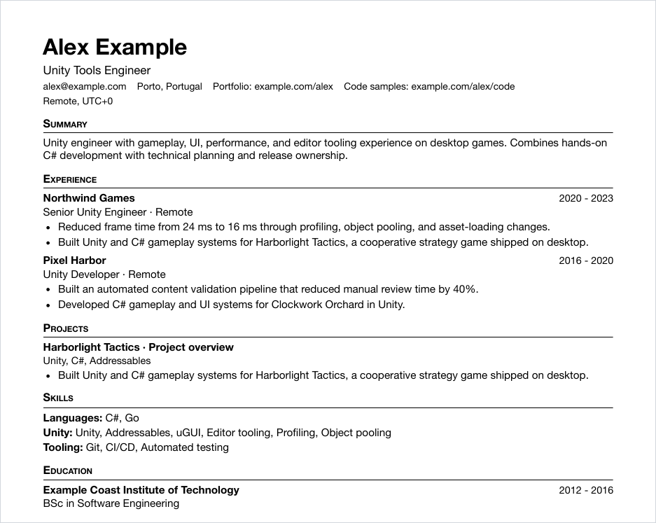
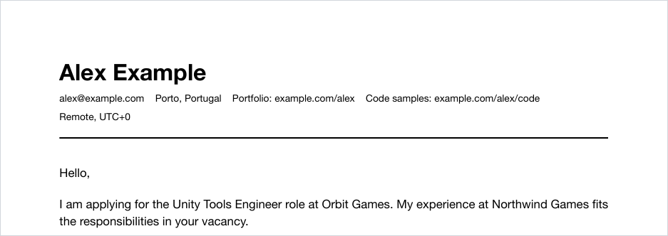

# JobForge

A self-hosted workspace for job applications that your AI agents prepare and you review.

Your agent reads your profile, finds vacancies, writes a tailored resume and cover letter for each one, and files them in JobForge over a REST API. You open a small web page, read the drafts, approve the good ones and send them yourself. JobForge has no AI inside and never sends anything. The agent does the writing; JobForge checks it against your facts and renders the PDFs.



## Why

Agents draft a decent resume for a vacancy. They also invent skills you don't have, and nobody tells them the resume now runs to two pages. JobForge sits between the agent and your inbox and refuses the bad drafts with a message the agent can act on.

You write an "About me" profile once, or let your agent build it from your CV. Every employer, project, date and skill in a resume has to exist in that profile. If you work across fields, keep one resume variant per kind of role (say Unity, Go and technical director) and the agent picks the closest one for each vacancy. Resumes are HTML files printed to PDF with headless Chrome, so changing the layout means editing a template. Agents can file drafts; only you can approve one or mark it as sent.

## How it works

```
Profile ─────────── every true fact about you, one per instance
   │
Resume variants ─── "Unity developer", "Go backend", "Technical director":
   │                 when to use it, a base resume, default templates
   │
Applications ────── one per vacancy: vacancy text and link, tailored resume,
                    cover letter, notes, status, history
```

An agent files an application with a single request. The server checks it against your profile, renders both PDFs and counts the pages. Then it either stores the result or returns everything that is wrong, with JSON paths:

```json
{ "error": { "code": "validation_failed", "message": "Resume failed the fact check.",
  "details": [{ "path": "resume.content.experience[1].company", "code": "unknown_employer",
               "message": "\"Foo Inc\" is not in the profile. Known: Brightledger, Northwind Games, Pixel Harbor." }] } }
```

## Quick start

You need Node.js 22.13 or newer and a Chromium-based browser (Chrome, Chromium, Edge or Brave) for PDFs. There are no npm packages to install.

```bash
git clone https://github.com/d4nilevi4/jobforge.git
cd jobforge
npm start
```

On first start JobForge prints an owner token, once. Copy it, open <http://127.0.0.1:8787> and paste it into the sign-in box. Your data goes in `./data`.

To look around first, fill a throwaway instance with a fictional candidate:

```bash
DATA_DIR=/tmp/jobforge-demo npm run seed
DATA_DIR=/tmp/jobforge-demo npm start
```

### Docker

```bash
docker compose up -d
docker compose logs jobforge | grep -i token   # the owner token, printed once
```

The image includes Chromium and fonts for Latin and Cyrillic. Data lives in a volume mounted at `/data`.

## Connect an agent

Open **Settings** and create a token. Start with the `setup` preset, because it lets the agent write your profile; switch to `agent` once the profile is filled in. Then give the agent the base URL and the token and tell it to read `/api/v1/guide`. The guide is written for agents and walks through setup and applying, including how to read the server's error messages.

A prompt that works with Claude Code, Codex, or any agent that can make HTTP requests:

> Use the JobForge API at http://127.0.0.1:8787/api/v1 with this token: `<token>`. Read /api/v1/guide first. Then fill in my profile from the attached CV and create resume variants for the roles I'm aiming at.

And later, for the actual applications:

> Use the JobForge API at http://127.0.0.1:8787/api/v1 with this token: `<token>`. Read /api/v1/guide, then find remote Go backend roles posted this week and file an application for each one that fits.

The repo includes a skill (`skills/jobforge-apply`) and a sub-agent definition (`skills/agents/tailor.md`) for running one agent per vacancy.

| Preset | What it can do |
|---|---|
| `agent` | Read everything, file and edit draft applications, write resume variants and templates |
| `setup` | The same, plus edit the profile |
| `owner` | Everything, including approving applications, managing tokens and exporting data |

## What's in the UI

### About me

Forms for identity, experience, projects, education, skills and languages, plus the rules your agents have to follow: things you must never claim, things you only know from a course, phrases you never want to read, a word limit for cover letters. There is also a JSON tab, and every save is kept in a revision history.



### Resume variants

One card per kind of role, with notes that tell the agent when to use it.



### Review

Each application shows the vacancy, both PDFs, the agent's notes, any warnings, and earlier applications to the same company. You approve, mark as sent, skip or delete from there.



### Templates

Four are built in: a classic one-page resume, a denser one-page resume, a roomier two-page A4 resume, and a cover letter. All are single column, with real text and real links, so applicant tracking systems can read them. Fork one and edit it in the browser.



Here is what an agent produced from the demo profile:

<p>
  
  
</p>

## The fact check

Every application and every resume variant goes through the same check before it is stored. These block the request:

- an employer, project, school or skill that isn't in the profile, or dates that differ from it
- something you only know from a course, mentioned without that qualifier
- a pattern from your "do not claim" list, or one of your forbidden phrases
- a cover letter over your word limit
- a resume longer than its template allows

These are stored and shown as warnings: numbers that appear nowhere in your profile, text in the wrong language, very long bullets, and lines-of-code counts.

Your name, email, phone and links never come from the agent. The server takes them from your profile when it renders.

## API

Everything is JSON under `/api/v1`, with a bearer token. The OpenAPI document is at `/api/v1/openapi.json` and the agent guide at `/api/v1/guide`.

```bash
curl -s http://127.0.0.1:8787/api/v1/tracks -H "Authorization: Bearer $TOKEN"

# dry run: stores nothing, but runs every check and renders the PDFs
curl -s -X POST http://127.0.0.1:8787/api/v1/check \
  -H "Authorization: Bearer $TOKEN" -H "Content-Type: application/json" \
  -d @application.json
```

[docs/api.md](docs/api.md) has an overview, and [docs/SPEC.md](docs/SPEC.md) is the full contract.

## Configuration

| Variable | Default | |
|---|---|---|
| `PORT` | `8787` | |
| `HOST` | `127.0.0.1` | Use `0.0.0.0` to listen on every interface. A token is always required, but put TLS in front if you do |
| `DATA_DIR` | `./data` | Database and generated files |
| `CHROME_BIN` | auto-detected | Path to Chrome, Chromium, Edge or Brave |
| `JOBFORGE_DOCKER` | unset | `1` adds `--no-sandbox` to Chrome, which most containers and CI runners need |

`npm run token -- --name codex --preset agent` creates another token, `npm run backup` copies the database, and `node server/cli.js doctor` checks Node, the data directory and Chrome.

## Upgrading

Pull the new code (or image) and restart. On startup JobForge copies the database to `data/backups/`, applies any new migrations, and refuses to open a database written by a newer version. Stored documents carry a schema version and are upgraded when read. Inside `/api/v1` changes only add things; anything breaking would go to `/api/v2`. [docs/upgrading.md](docs/upgrading.md) has the details and a rollback recipe. To move data between instances, use `node server/cli.js export` and `import`.

## Development

```bash
npm test
```

The suite starts real servers on random ports with temporary data directories. PDF tests skip themselves when there is no Chrome. Please read [AGENTS.md](AGENTS.md) and [CONTRIBUTING.md](CONTRIBUTING.md) before sending a change. In short: no runtime dependencies, English everywhere, and nothing that can lose someone's data.

Most of the code was written by coding agents (Codex) under human direction, reviewed by a second agent, and is covered by the test suite and CI.

## Limits

- One person per instance. There are no accounts, only tokens.
- JobForge doesn't search for vacancies, fetch job pages or send applications. Your agent brings the vacancy and you send the application.
- PDFs need a Chromium-based browser on the server.
- The web UI is English only. Resumes and letters can be in any language.

## License

[MIT](LICENSE)
